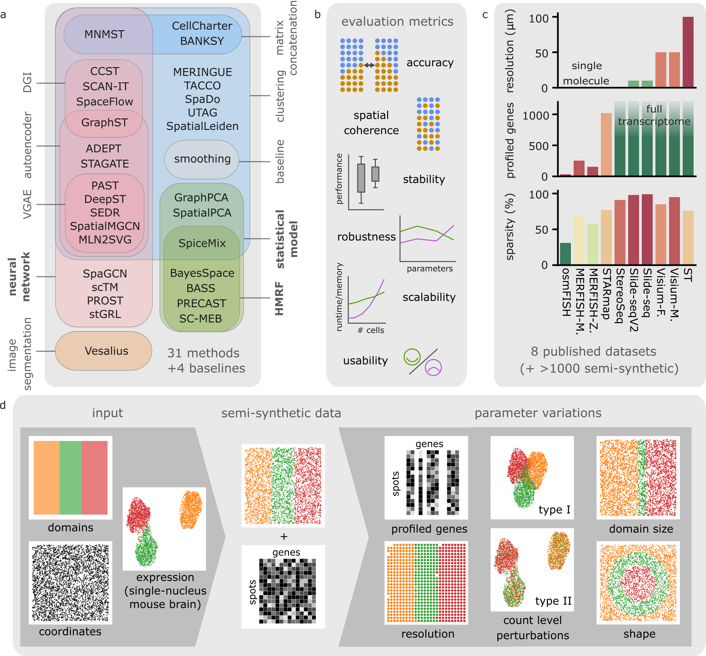

# Spatial Domain Analysis Framework



This repository contains the [Snakemake](https://snakemake.readthedocs.io/en/stable/)-based workflow for benchmarking and analyzing methods for spatial domain identification from spatial transcriptomics data.

> The spatial organization of cells within tissues is critical for understanding biological function and disease, and spatial transcriptomics enables genome-wide mapping of this organization. Numerous computational methods aim to identify spatial domains, yet their performance is often evaluated on limited datasets, leading to conflicting conclusions. Here, we present an explanatory benchmark of 31 spatial domain detection methods across 94 tissue sections from eight spatial transcriptomics technologies, supplemented by over 930 semi-synthetic datasets that systematically vary resolution, gene panel size, and tissue architecture. By jointly analyzing real and semi-synthetic data across this broad parameter space, our benchmark uncovers systematic performance differences and sources of variability that are obscured in standard evaluations. Although most spatial methods outperform non-spatial baselines, their performance depends strongly on data resolution and cellular heterogeneity. To enable systematic analysis beyond individual methods, we introduce a modular, plug-and-play benchmarking framework that facilitates method refinement and component exchange. Using this framework, an ablation study of neural network-based approaches shows that the choice of preprocessing and clustering often has a larger impact on performance than architectural novelty alone. Together, these results provide a principled foundation for informed method selection and offer guidance for the development of robust and scalable spatial domain detection tools as spatial transcriptomics technologies continue to advance.

The repository is set up for users to be able to immediately run the workflow upon cloning, provided Snakemake is installed (see the docs linked above). We provide one sample of data from the osmFISH technology (original download [here](https://linnarssonlab.org/osmFISH/availability/)). Further, we provide the results (in terms of metrics) of our entire benchmarking effort.

A jupyter notebook details analysis and visualization options and allows the reproduction of most relevant figures from our manuscript.

This is the sister repository to our [spatial domain simulator](https://github.com/canzarlab/spatial-domain-simulator).

## Cloning the repo, installing snakemake and running the workflow

To get started, simply clone this repository into a local folder on your machine: 
```sh
git clone https://github.com/canzarlab/spatial-domain-analysis-framework spatial_domain_analysis
```
Software dependencies are handled within Snakemake through [conda](https://docs.conda.io/projects/conda/en/latest/user-guide/install/index.html). Please ensure you have created (and activated) an environment containing [Snakemake](https://snakemake.readthedocs.io/en/stable/getting_started/installation.html) and pandas: 
```sh
conda create -c conda-forge -c bioconda -c nodefaults -n snakemake_env snakemake pandas
conda activate snakemake_env
```
In order to perform a dry run, use:
```sh
snakemake -j 10 --use-conda -n
```
Now you're ready to run the workflow using the following command: 
```sh
snakemake -j 10 --use-conda -k
```
Once the workflow is running, if it's taking a long time (happens if you're running a lot of methods and/or a lot of samples) and you want to get an overview of where the evaluation is standing, use the following command: 
```sh
watch -n 10 python snakemake_dashboard.py
```
This will provide you with a dashboard type overview of the number of samples already processed by each method, along with any samples on which methods fail to produce reasonable output. 

## Adding datasets

Supposing you want to run the Snakemake workflow on more datasets than the osmFISH sample provided within this repository. You will need to *manually* download an additional dataset and bring the data into the expected formatting and file structure: 
``` sh
└── resources
    └── <dataset-name>
        ├── <sample-name>_UMImatrix.csv  # spots x genes matrix without row or column names
        ├── <sample-name>_coords.csv  # two columns with x and y coordinates, no headers or index
        └── <sample-name>_labels.csv  # one column with ground truth labels, no header or index
```
Additional samples can be added to the same dataset folder. Please ensure that the order of cells/spots is the same within all three files per sample. 

The sources of datasets which were utilized in our evaluation are found in Supplementary Note 2 of our paper. 

After you have added all necessary files, please run: 
```sh
python add-dataset.py --dataset <dataset-name>
```
This will automatically create the necessary entries in the `config/datasets.csv` and `config/samples.csv` files, and your dataset will be included in the next workflow run. 

## Adding methods

To add a new method to the analysis workflow, add it as a line in `config/methods.csv`. 

Additionally, you will need to add files to three folders within the workflow structure: 

### workflow/envs

To this folder, add a `.yaml` file detailing required packages for running your method. This file should be called `<your-method-name>.yml`and have the following format: 
```yaml
name: <your-method-name>
channels:
 - conda-forge  # and/or any other required channels
dependencies:
 - <your-method>
 - numpy
 - ...
```
In case your method cannot be installed through conda, you can add an additional file called `<your-method-name>.post-deploy.sh`. This file should contain instructions to installing the method, e.g.: 
```sh
if [ ! -d workflow/scripts/<your-method-name> ] ; then
    git clone https://github.com/<developers>/<your-method-name> workflow/scripts/<your-method-name> ;
fi
```
or
```sh
Rscript workflow/envs/<your-method-name>_install.R
```
with an accompanying R script file
```R
remotes::install_github("<developers>/<your-method-name>")
```
and/or any other installation instructions. 

### workflow/rules

To this folder, add a `.smk` file detailing how to run your method. This should be standardized within this workflow, so simply copy/paste the following, filling our your method name: 
```smk
rule <your-method-name>_clustering:
  input: 
    os.path.join('workflow','scripts','<your-method-name>_run.py'),  # or .R
    os.path.join('resources','{dataset}','{sample}_UMImatrix.csv'),
    os.path.join('resources','{dataset}','{sample}_coords.csv'),
  output:
    os.path.join('results','{dataset}',<your-method-name>','{sample}','clustering.tsv'),
  params:
    script = os.path.join('workflow','scripts','<your-method-name>_run.py'),
    n_domains = get_n_domains,
  log:    
    os.path.join('results','{dataset}','<your-method-name>','{sample}','<your-method-name>.log')
  benchmark:
    os.path.join('results','{dataset}','<your-method-name>','{sample}','benchmark.tsv')
  conda:
    '../envs/<your-method-name>.yml'
  shell:
    'python {params.script} -d {wildcards.dataset} -s {wildcards.sample} -n {params.n_domains}'
    # 'Rscript {params.script} {wildcards.dataset} {wildcards.sample} {params.n_domains}'  # or this in case of Rscript
    '&> {log}'
```

Additionally, you need to add a line to the `Snakefile` in order to include your method. 

### workflow/scripts

To this folder, add a `.py` or `.R` script running your method. 

This script should take in arguments specifying the dataset and sample names, as well as the target number of domains. 

As an output, your script should provide clustering results in the file `results/<dataset-name>/<your-method-name>/<sample-name>/clustering.tsv`, formatted as one single column with a header and no index. Take care that your script outputs labels for **all input cells/spots** in the order they are input, as otherwise the alignment will be off. 

For examples on how this script should/could look, take a look at the other scripts contained in `workflow/scripts`. 

## Adding modules

To add a module to the plug-and-play neural network ablation framework, add any dependencies to `workflow/envs/chimera.yml` and implement your module as a function in the file `workflow/scripts/chimera_run.py`. Additionally, add your method as an option for the argument parser, and ensure your module runs when it is passed as an argument. 

Finally, create a rule to run your desired component combination(s) in `workflow/rules/chimeras.smk`, combining preprocessing, adjacency, neural network and clustering modules and giving your combination a name. This name should finally be added to `config/methods.csv` as a method, and you're ready to run your module. 

## Troubleshooting

<details>
<summary> A method doesn't run on one of the samples, and so the Snakemake doesn't terminate correctly. </summary>

Ensure you run the workflow with the `-k` flag (for "keep going"), this will make sure all combinations that don't fail still run through. 

Once the Snakemake finishes running, run `python collect_scores.py` manually to collect all available scores into the `scores.csv` file. 

</details>

## Citation

Descoeudres, A., Prusina, T., Schmidt, N., Do, V. H., Mages, S., Klughammer, J., Matijevic, D., & Canzar, S. (2026). An explanatory benchmark of spatial domain detection reveals key drivers of method performance. bioRxiv. [doi.org/10.64898/2026.03.12.710462](https://doi.org/10.64898/2026.03.12.710462)
